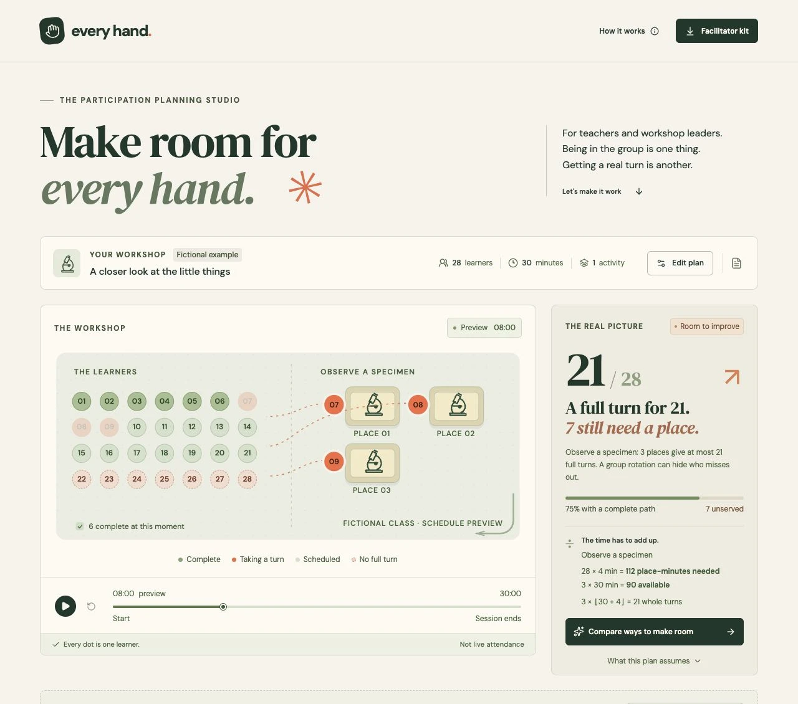
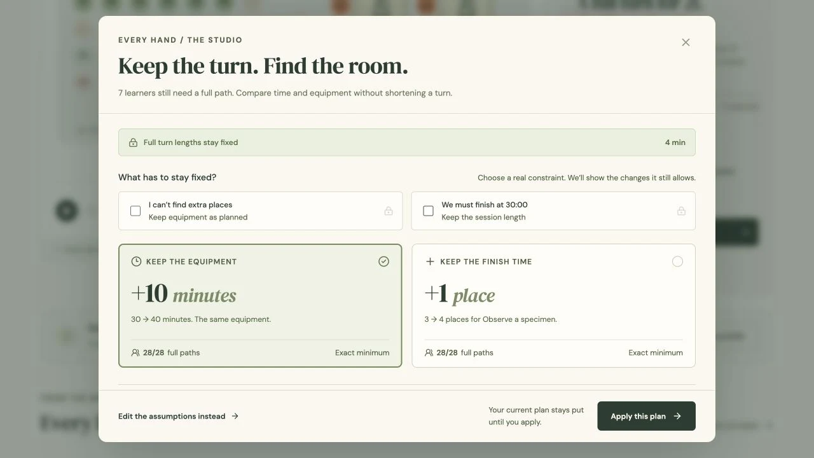

# Every Hand

**Make room for every learner's hands-on turn.**

Every Hand is a workshop planning studio for teachers and facilitators. It schedules complete **individual** opportunities, then compares actual ways to make room: keep the equipment and add time, or keep the finish time and add places. Full turn lengths stay fixed, named learner paths show the consequence, and recovery preserves work already done.

The [submission film source](videos/everyhand-demo/README.md) includes the story, actual demo captures, word-timed narration, original music and reproducible 1080p60 rendering instructions.





The fictional microscope example makes the difference visible:

| Plan | Complete individual turns | Learners still missing a turn |
| --- | ---: | ---: |
| 28 learners · 30 minutes · 4 minutes each · 3 microscopes | 21 | 7 |
| The same lesson with a fourth microscope | 28 | 0 |
| The same three microscopes, with 40 minutes instead of 30 | 28 | 0 |

Three microscopes provide 90 microscope-minutes against 112 needed. The stronger whole-turn limit is `3 × floor(30 / 4) = 21`. Four microscopes fit seven waves and finish all 28 turns at minute 28.

## Try it locally

Requires Node.js **22.12 or later** and npm.

```sh
npm install
npm run dev
```

Open [localhost:5174](http://localhost:5174). The sample, manual editor, solver, timeline, simulated loss and exports all work without an API key or backend.

For optional AI lesson import, create an ignored `.env` using `.env.example` as a reference, add your own `OPENAI_API_KEY`, and run in a second terminal:

```sh
npm run server
```

The local API listens on `127.0.0.1:3002`; Vite proxies `/api` to it. The default import model is `gpt-5.4-mini`; `OPENAI_IMPORT_MODEL` can override it with a model that supports structured outputs. The app sends lesson text to OpenAI only after the explicit **Create a draft** action. Draft fields remain editable and require applying before the current plan changes. API usage may incur charges under your account.

## Host on Vercel

Use this `EveryHand` directory as the Vercel project root, the Vite framework preset, Node.js 24, `npm run build`, and the `dist` output directory. `vercel.json` routes `/api/*` to one Node function; the shared handler does not start the local HTTP server. No database, paid add-on, cron job or external storage is required. Deploy only within the account's existing free hosting allowance; hosting usage limits still apply.

Set `OPENAI_API_KEY` in Vercel's server environment settings for each desired deployment environment. Optionally set `OPENAI_IMPORT_MODEL`; never prefix either with `VITE_`. The key is never bundled into the browser. `.vercelignore` excludes all `.env*` files, planning files, video sources/renders and local artifacts from deployment uploads. Without a key, the manual app remains available and AI import returns a clear configuration message.

Production import requests must use JSON and have the same HTTPS origin as the deployment. Notes are bounded to 10,000 characters and 24,000 UTF-8 bytes; OpenAI calls have a 25-second timeout and a 2,500-token output limit. The 30-second function limit bounds execution. Each warm function instance also permits at most two concurrent imports and six starts per minute. These memory counters reset and are **not a deployment-wide rate limit or spending cap**. Origin checks restrict browser requests but do not authenticate users. OpenAI usage remains billable under the existing API account; configure provider project budgets/limits and Vercel usage controls as appropriate for a public demo.

After deployment, check `/api/health` for `ok: true` and `aiConfigured: true`, then create and review one lesson draft through the app. Keep the server key out of URLs, screenshots and logs.

## Walk through the proof

1. Start with the labeled fictional example. Inspect **21 / 28** and the seven learners needing a turn.
2. Choose **Compare ways to make room**. Preview **10 extra minutes** with the same equipment, or **one extra place** with the same finish time. Both preserve the full four-minute turn. Lock time or equipment to reflect a real constraint.
3. Inspect a named learner’s actual before/after path, then apply the equipment option. The schedule becomes **28 / 28**. Preview alone leaves the plan unchanged.
4. Play or scrub the room. Select a learner to inspect their exact time and place.
5. At minute 8, choose **Lose a place**. The four-place example becomes **23 / 28**; eight completed turns stay preserved. Compare recovery: **six extra minutes** restores all 28 with the same three remaining places. Apply the actual 36-minute recovery plan or use undo.
6. Open **Facilitator kit**. Print the chronological run sheet and individual cards, or download the actual JSON/CSV schedule.
7. Edit or paste a different lesson. Up to four activities run in the specified prerequisite order; each learner needs a complete turn in each activity.

## How scheduling works

The pure TypeScript scheduler assigns non-preemptive, whole-minute slots while enforcing one learner per place, no learner/resource overlap and ordered prerequisites. It chooses eligible learners deterministically, with downstream activities scheduled first at a time step and roster order as a stable tie break.

The single-activity whole-turn bound is exact. A per-activity capacity shortfall is a necessary impossibility bound. **Multi-activity scheduling is a heuristic:** failure to serve everyone does not prove that no better ordering exists. The interface distinguishes a proven equipment bound from a schedule that needs timing review. If an activity exceeds the session length, no resource count fixes it; the interface asks for a timing change.

At simulated resource loss, slots completed by the cutoff remain immutable. Active turns on surviving places finish. An interrupted turn on the lost place restarts at its full duration if time remains. Future turns are rebuilt from the remaining capacity. Rewinding the preview before the cutoff shows the historical resource count.

## Choosing a workable change

The comparison engine generates complete schedules, not estimated scores. Baseline single-activity options use exact whole-turn bounds. After a resource loss, the bound includes completed turns and each surviving place’s next-free time. This is why the original shortfall needs ten extra minutes, while the minute-eight recovery needs only six.

Multi-activity options are labeled **verified**, with no global-minimum claim. The search checks later integer horizons through 120 minutes and increases to one activity at a time through 16 places. No result within this bounded search does not prove that combined changes or another ordering cannot work.

Every candidate retains the original learners, activity order and full durations. Applying rechecks the source revision, lock settings, actual schedule and protected history; a stale preview cannot overwrite a changed plan. Time/equipment deltas, gained learner names and moved future turns are computed from actual before/after slots. A compact named learner proof sits beside the choices on desktop, showing a missing turn become a real time and place as each option is previewed; the full learner inspector remains below. Exports read the applied schedule.

## Verification

```sh
npm test
npm run check
npm run build
```

The 23 tests cover the canonical 21/28 and 28/28 fixtures, +10-minute/+1-place alternatives and +6-minute recovery, locks, immutable preview and stale/tampered application rejection, 100 deterministic randomized plans, independent overlap/dependency invariants, disruption boundaries and mid-turn restart, invalid inputs, local and production import HTTP boundaries and per-instance burst protection, CSV data parity and spreadsheet formula escaping. See [the verification record](devpost/verification.md) for browser and live API evidence.

## Project map

| File | Responsibility |
| --- | --- |
| `src/choices.ts` | Actual alternatives, exact/verified evidence, protected history and stale-apply checks |
| `src/ChoiceWorkspace.tsx` | Constraint locks and named learner before/after preview |
| `src/solver.ts` | Plan validation, deterministic scheduling, capacity proofs and disruption repair |
| `src/solver.test.ts` | Scheduling fixtures and independent invariants |
| `src/App.tsx` | Editing, timeline state, import review, learner detail and printable kit |
| `src/Room.tsx` | SVG room driven by actual slots |
| `src/export.ts` | CSV escaping and file downloads |
| `server/import.ts` | Shared bounded, validated OpenAI importer and request handler |
| `server/index.ts` | Local HTTP server adapter |
| `api/index.ts` | Vercel Node function adapter |
| `src/styles.css` | Editorial studio, responsive layout, reduced motion and print styling |
| `devpost/` | Scope, PRD, technical spec, build checklist and offline app map |

[Open the offline app map](devpost/app-map.html) for a short reference route through one real interaction.

## Boundaries and data

- 1–60 learners, a 5–120-minute session, 1–4 ordered activities, whole-minute turns and 1–16 simultaneous places. A simulated loss can reduce a task to zero places.
- Each activity has its own dedicated equipment pool. Shared equipment across separate activities is not modeled; combine those steps into a single activity with a full combined duration.
- Durations include reset and movement; no additional physical travel time or learner availability model is inferred.
- The room is a schedule preview. **A planned opportunity is not observed participation or evidence of learning.**
- The current baseline plan is saved in this browser using versioned, validated local storage. The simulated loss, playback position and pasted import text are not persisted. Refresh returns to the baseline plan.
- No accounts, collaboration, analytics, database or attendance hardware. The optional local server binds only to localhost; the Vercel function accepts same-origin HTTPS imports. Neither logs pasted text, API keys or raw provider errors.
- Local storage can be cleared through browser settings. Use anonymous labels when entering or importing classroom notes.
- No classroom pilot, endorsement or educational-effectiveness claim is made. Human final review and the required narrated demo/submission remain pending.

## Planning and attribution

This new project uses the **Devpost Learn Build With AI: Basics** skill pack, installed before application code. The public [scope](devpost/scope.md), [PRD](devpost/prd.md), [spec](devpost/spec.md) and [checklist](devpost/checklist.md) record the plan and implementation. Documents remain marked draft because the user delegated implementation and has not personally reviewed each document; no interview or sign-off was invented. `skills-lock.json` records installation provenance.

Application code and workshop vectors were created for this project with AI coding assistance. React, Vite, TypeScript, Lucide and tsx are third-party dependencies recorded in the lockfile. DM Sans and DM Serif Display are bundled locally under their included SIL Open Font Licenses in `public/fonts/`; the app does not fetch fonts from a third-party service at runtime. OpenAI structured-output extraction is optional.

Application source is MIT licensed. Font files retain their separate OFL licenses.
